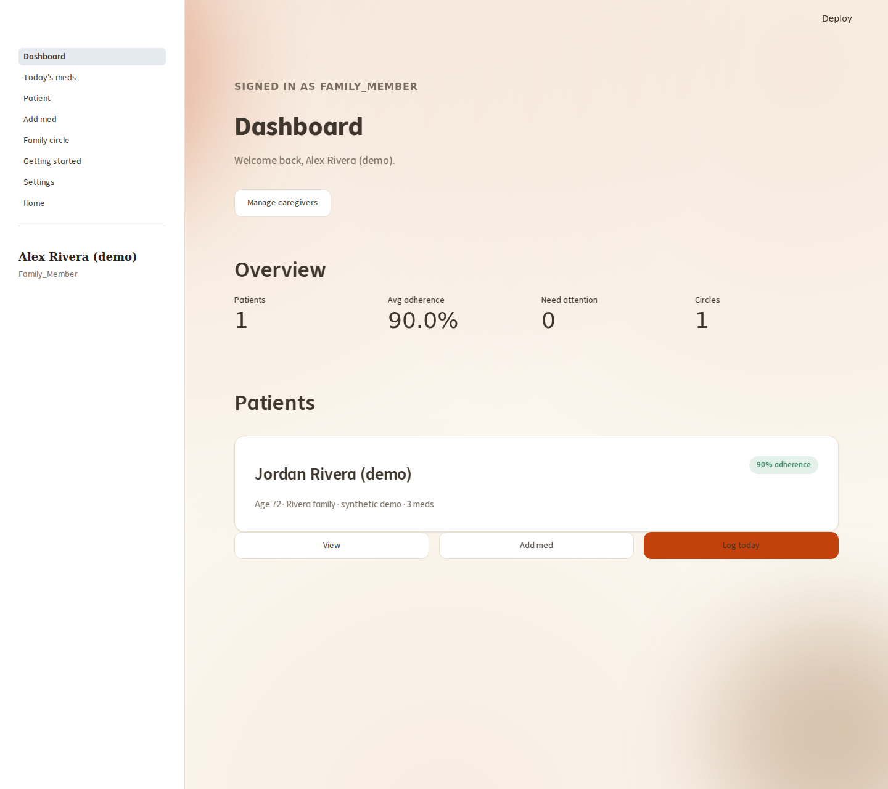
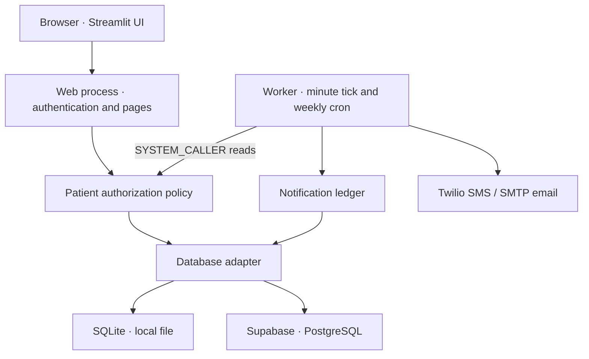

# MedSync · Medication tracking with a family support circle

[](https://github.com/dprasath3/medication-tracker/actions/workflows/ci.yml)
[](.python-version)
[](LICENSE)

MedSync helps patients keep track of daily medications and lets trusted family members help manage the schedule. Patients see what is scheduled and record doses; caregivers see shared patient summaries, history, and medication management controls.

**Python · Streamlit · SQLite / Supabase PostgreSQL · APScheduler · Twilio · pytest · GitHub Actions**

The engineering focus is **permission-aware data access and recoverable background work**: both database adapters share an authorization policy, and a separate worker reconciles outstanding reminders against a persistent notification ledger.

> Portfolio prototype with a reproducible local demo. No live deployment, clinical validation, compliance certification, or ML model is claimed. Use synthetic data when evaluating it.



*Real application capture, local SQLite, synthetic records. Percentages describe the seeded example—not an outcome study. [More screenshots and reproduction steps →](docs/DEMO.md)*

## What you can do

- **Track a daily schedule:** ordered medication cards, dose logging, progress, and a session-local 30-minute snooze.
- **Coordinate family care:** create/join circles, view shared patients, and let the circle creator grant or revoke medication-management permission.
- **Manage medication records:** add, edit dose/schedule/notes, deactivate, and reactivate. Names are locked because existing history references them by name.
- **Authenticate:** phone OTP with keyed HMAC storage, expiry, attempt limits, and request throttling; email/password with bcrypt; database-backed session tokens.
- **Run background reminders:** patient SMS at T+0, follow-up at T+30 minutes, caregiver alert at T+60; stop escalation once a dose is logged. Delivery requires a separately configured worker and provider credentials.
- **Review history:** Plotly adherence trends, caregiver summaries, and a scheduled weekly email-report path. Historical adherence is taken ÷ explicitly logged doses; unlogged doses are excluded.
- **Choose a theme:** warm cream, cool sage, twilight, or high contrast, persisted per user. Accessibility targets are documented; conformance has not been certified.

## Engineering highlights

| Decision | Implementation and tradeoff |
| --- | --- |
| Enforce patient permissions below the UI | Both adapters inherit [`PatientAuthorizationMixin`](src/utils/authz.py). Reads require `view`; writes require `manage_meds`; patients can access their own records. Denials raise `AuthorizationError`. Tests cover unrelated callers and forged patient IDs. |
| Give background jobs an explicit identity | `SYSTEM_CALLER` is an object sentinel, not a user-supplied integer. It permits reads through the patient policy and rejects patient-data writes. Worker ledger methods are separate trusted operations. |
| Recompute work after restarts | [`tick(db, notifier, now)`](src/services/reminder_engine.py) checks current-day schedules and a unique dose/stage ledger every minute. Catch-up sends only the most advanced due stage. Completed records suppress sequential repeats; this is **not exactly-once SMS delivery**. |
| Keep local development independent of cloud services | [`db_factory.py`](src/utils/db_factory.py) selects SQLite without credentials and Supabase when both variables are set. A disposable demo exercises the actual UI and SQLite adapter. Hosted adapter integration still needs a dedicated test environment. |
| Test observable behavior | Tests cover authorization, OTP rejection/replay/limits, session expiry, reminder stages/retries, and scheduler integration. Tests block network connections and use temporary databases or fake notifiers. |

## Architecture



The server holds the Supabase service key; browsers do not get a database client or that key. The proposed schema enables RLS and revokes direct client-role access, while the service role still relies on Python authorization. This is distinct from per-user Supabase Auth/RLS, which is future work. No hosted schema was changed during this audit.

[Architecture, data model, and source map](docs/ARCHITECTURE.md) · [Security boundaries and known gaps](SECURITY.md) · [Reminder delivery semantics](REMINDER_ENGINE.md)

## Run the synthetic demo

Requires Python 3.11. From a terminal:

```bash
git clone https://github.com/dprasath3/medication-tracker.git
cd medication-tracker
python3.11 -m venv .venv
source .venv/bin/activate            # Windows: .venv\Scripts\activate
python -m pip install -r requirements.txt
python scripts/demo.py
```

Open `http://localhost:8501`, choose **Use email instead**, and use one of the accounts plus the temporary password printed in your terminal:

| Account | Demonstrates |
| --- | --- |
| `patient@example.test` | Today's schedule and dose logging |
| `caregiver@example.test` | Dashboard, history, medication management |
| `viewer@example.test` | Shared read access without write controls |

The launcher creates a **new temporary SQLite database**, clears cloud/SMS/email credentials in the child environment, binds to loopback, and does not start a worker. It deletes the demo directory on normal exit. Sample medication names and doses are fictional. No `.env` or real phone number is needed.

## Standard local setup

For an empty local database, after installing dependencies:

```bash
cp .env.example .env
# Leave Supabase, Twilio, and email credentials empty for local evaluation.
streamlit run src/web_app.py
```

SQLite is created at `data/medications.db`, relative to the launch directory. Register with email/password, or explicitly enable **both** `MEDSYNC_LOCAL_DEMO=1` and `MEDSYNC_DEV_SHOW_OTP=1` for local phone-flow testing without SMS and without Supabase configuration. Both flags must stay off in deployed environments. Guest/reset controls require the local-demo flag and no Supabase configuration. Without SMS or the explicit local test mode, phone sign-in reports that it is unavailable instead of claiming a code was sent.

### Optional cloud / worker configuration

| Configuration | Purpose |
| --- | --- |
| `SUPABASE_URL`, `SUPABASE_KEY` | Shared database; the key must be server-only and use the service role. Review [`supabase_schema.sql`](supabase_schema.sql) in a disposable project first. |
| `MEDSYNC_OTP_SECRET` | Stable random server secret for OTP HMACs; otherwise pending OTPs do not survive process restart. |
| `TWILIO_ACCOUNT_SID`, `TWILIO_AUTH_TOKEN`, `TWILIO_PHONE_NUMBER` | Phone authentication and reminder SMS. Leave empty for demos. |
| `APP_TIMEZONE` | Reminder worker and weekly cron timezone; UI/logging still have timezone limitations. |
| `APP_BASE_URL` | Base for email links; verification/reset browser handlers remain unfinished. |
| `EMAIL_ADDRESS`, `EMAIL_PASSWORD`, `SMTP_SERVER`, `SMTP_PORT` | Optional SMTP email path. |

The real delivery command is `python src/main.py --start`. **It can send messages** when credentials and recipients are configured. Use fake notifiers in tests to inspect reminder behavior. For separate containers, web and one worker need the same Supabase database; local processes can share the same SQLite file when launched from the same directory. [`Procfile`](Procfile) is a deployment recipe, not evidence of a running deployment.

## Tests and CI

```bash
python -m pip install -r requirements.txt -r requirements-dev.txt
python -m pytest -q
ruff check .
```

**Verified result:** 99 Python tests and Ruff pass locally and in [GitHub CI](https://github.com/dprasath3/medication-tracker/actions/runs/41917122698), up from 67 tests at baseline `e8e59c4`. The strengthened PostgreSQL 16 access-boundary job also passed. [Exact verification results, commands, and limits](docs/TESTING.md) distinguish each revision; the badge links to the real workflow and reports **main**, not an unmerged PR. [Final review and merge conditions](docs/FINAL_REVIEW.md).

| Area | Evidence |
| --- | --- |
| Authorization and medication lifecycle | [`tests/test_authorization.py`](tests/test_authorization.py) |
| OTP security and issuance limits | [`tests/test_otp.py`](tests/test_otp.py) |
| Sessions and sign-in routing | [`tests/test_session_persistence.py`](tests/test_session_persistence.py), [`tests/test_auth_ui.py`](tests/test_auth_ui.py) |
| Reminder timing, retries, ledger, messages | [`tests/test_reminder_engine.py`](tests/test_reminder_engine.py), [`tests/test_reminder_ledger.py`](tests/test_reminder_ledger.py), [`tests/test_notification_messages.py`](tests/test_notification_messages.py) |
| Scheduler wiring and timezone | [`tests/test_scheduler.py`](tests/test_scheduler.py) |
| Demo isolation / actual browser walkthrough | [`tests/test_demo.py`](tests/test_demo.py), [`scripts/capture_demo.py`](scripts/capture_demo.py) |
| Database API roles | [`tests/sql/server_access.sql`](tests/sql/server_access.sql), [CI](.github/workflows/ci.yml) |
| Final security regressions | [`tests/test_final_review.py`](tests/test_final_review.py): session revalidation, demo OTP gating, rendering, and Supabase count contract |

## Current limits and next steps

1. **Identity and deployment security:** replace URL bearer tokens with a secure session transport; complete reset/verification UI; validate hosted database grants and adapter behavior in an isolated environment. Some internal user/circle methods rely on trusted callers. See [security review](SECURITY.md).
2. **Delivery and data correctness:** add atomic work claiming / an outbox and per-recipient results; introduce medication/dose IDs and uniqueness; align UI, storage, and scheduling timezones. Current-day reconciliation does not catch up previous-day doses.
3. **Broader verification and optional ML research:** expand browser and backend contract tests, lock reviewed dependencies, and measure accessibility. An offline, synthetic-data adherence-risk experiment could follow with time-aware splits, baseline comparisons, calibration, and leakage checks. **No AI/ML model or predictive feature is implemented today.**

The current project demonstrates backend engineering, relational data modeling, background processing, and application-security tradeoffs. Its summaries and alerts are deterministic rules, not machine learning.

## Design and project history

The UI uses Fraunces/Instrument Sans font declarations, reusable CSS tokens, four themes, and reduced-motion CSS. The [design specification](design-system/MASTER.md) and [Today-page design intent](design-system/pages/today.md) preserve the original rationale; they are targets, not proof that every detail or contrast ratio is implemented. External font availability affects rendering.

[`HARDENING_SPRINT.md`](HARDENING_SPRINT.md) preserves the earlier sprint brief with a current-status map. Its original “zero tests,” deferred reminder engine, and RLS advice are historical. [`docs/AUDIT.md`](docs/AUDIT.md) records this review, changes, and outstanding issues. [`CLAUDE.md`](CLAUDE.md) contains contributor guidance. The vendored [ui-ux-pro-max design tooling](https://github.com/nextlevelbuilder/ui-ux-pro-max-skill) lives under `.claude/skills/`; it is development tooling, not an ML feature of MedSync.

Licensed under [MIT](LICENSE).
