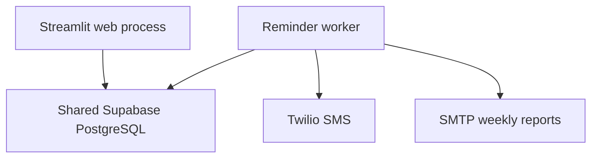

# Reminder delivery engine — design

Status: **reconciliation engine implemented; delivery guarantees are limited.**
This document records implemented behavior and its original design decisions.
Deployment instructions are a recipe; no live deployment was verified.
See [verification](docs/TESTING.md) and [security review](SECURITY.md).

---

## Goal

When a dose is due, prompt the patient; if they don't log it, follow up; if
they still don't, alert a caregiver. Concretely, a **two-stage escalation**
per scheduled dose:

| Stage | Offset | Recipient | Condition |
|-------|--------|-----------|-----------|
| `patient_reminder` | T+0 | patient (SMS) | dose not already logged |
| `patient_followup` | T+30 min | patient (SMS) | dose still not logged |
| `caregiver_alert`  | T+60 min | caregivers (SMS) | dose still not logged |

SMS is the primary channel (Twilio, already wired). A dose logged as taken
**or** explicitly missed halts further escalation.

## Architecture

Recommended separate-container layout:



**Why separate containers need shared storage:** web and worker are separate Railway
containers with separate filesystems. SQLite (a local file) cannot be seen by
both. The worker answering "did the patient log this dose?" requires reading
the same rows the web app writes. Both processes select the Supabase backend
via `utils.db_factory.get_database()` when `SUPABASE_URL`/`SUPABASE_KEY` are
set. Local processes on the same machine can share one SQLite file; separate
containers cannot assume the same filesystem.

## Locked decisions

1. **Timezone — single `APP_TIMEZONE`.** All `HH:MM` dose times are
   interpreted in one deployment-wide timezone (env `APP_TIMEZONE`, e.g.
   `America/New_York`). `scheduled_time`/`actual_time` are naive TEXT columns;
   this is the documented ceiling. Per-user timezones (a `users.timezone`
   column) is the eventual fix and is out of scope here.
2. **Catch-up — most-advanced stage only.** After worker downtime, an overdue
   dose sends only the single most-advanced due stage (e.g. a 70-min-overdue,
   unlogged dose sends the caregiver alert). Earlier stages are recorded as
   *superseded* in the ledger so they never fire late. No burst of texts.
3. **No auto-miss.** The engine never writes dose data. Adherence continues to
   count only explicitly logged doses. The worker's only patient-data access is
   read-only (via `SYSTEM_CALLER`); its sole writes are to its own
   `notification_log` ledger.

## The reconciliation model

The engine does **not** hold per-dose timers in memory. Every minute it
recomputes desired state from the DB and sends whatever is due but unsent.
This recovers outstanding **current-day** work after a normal restart without
rebuilding in-memory dose timers. It does not recover prior-day doses or make
the external send atomic with the database write.

`tick(db, notifier, now)` — injectable orchestration with database/SMS side effects (inject `now` and a
fake `notifier` → fully unit-testable, no real clock, no real SMS):

```
now    = current time in APP_TIMEZONE
today  = now.date()
for med in active medications (role=patient, read as SYSTEM_CALLER):
    if med.frequency == 'as_needed':  continue          # never nag PRN meds
    for dose_time in med.times:
        scheduled = today @ dose_time in APP_TIMEZONE
        delta_min = minutes(now - scheduled)
        if delta_min < 0:  continue                      # future dose
        logged = db.get_dose_log_for_date(SYSTEM_CALLER, ...) is not None

        due = []
        if delta_min >= 0  and not logged: due += ['patient_reminder']
        if delta_min >= 30 and not logged: due += ['patient_followup']
        if delta_min >= 60 and not logged: due += ['caregiver_alert']

        # send only the highest not-yet-sent stage; supersede the rest
        target = highest stage in `due` where not db.notification_sent(...)
        for earlier unsent stage below target: db.record_notification(...)  # supersede, no send
        if target and send(target) succeeds: db.record_notification(target)
```

### Idempotency

Every send is gated by `notification_sent(...)`, backed by a UNIQUE
constraint on `(patient_id, medication_name, scheduled_time, date, stage)`.
A completed ledger record suppresses the stage on later sequential ticks.
The UNIQUE constraint deduplicates ledger **rows**, not external SMS sends:

- A crash or database failure after provider acceptance but before recording
  can cause a duplicate on retry.
- Two worker processes can both observe an unsent stage and send before either
  records it. Run one worker; `max_instances=1` only prevents in-process overlap.
- A successful provider API call means accepted, not confirmed delivered.
- A caregiver stage is marked handled when **any** recipient send succeeds;
  failed recipients are not individually retried after that.

An atomic outbox/claim protocol, delivery reconciliation, and per-recipient
records are follow-up work. There is no exactly-once delivery guarantee.

## Data model — `notification_log`

```
id, patient_id, medication_name, scheduled_time, date, stage, sent_at
UNIQUE(patient_id, medication_name, scheduled_time, date, stage)
```

`stage ∈ {patient_reminder, patient_followup, caregiver_alert}`. A superseded
stage is recorded the same way as a sent one — the ledger records "this stage
will not fire," whether because it was sent or skipped. (The dead `reminders`
table is unrelated and left for a later cleanup.)

## Implementation inventory

**Existing supporting code:** `notifications.send_sms` (Twilio); `SYSTEM_CALLER` +
`get_patient_medications(SYSTEM_CALLER, …)`; `get_dose_log_for_date`
(the escalation predicate); `get_family_circle_members`; `main.py --start`
worker entrypoint; `db_factory.get_database()`.

**Implemented stages (see source and tests):**
1. `notification_log` table (both backends + `supabase_schema.sql`) +
   `record_notification`/`notification_sent` (idempotent) +
   `get_caregiver_contacts(patient_id)` (family members with a phone, deduped).
2. `send_dose_followup` + `send_caregiver_alert` in `notifications.py`.
3. `services/reminder_engine.py` `tick()` (the logic above; the bulk of tests).
4. Rework `scheduler.py`: one `IntervalTrigger(minutes=1)` → `tick`; keep the
   weekly-report cron; build DB via `get_database()` (fixes the `scheduler.py`
   hardcoded SQLite import); set the scheduler timezone to `APP_TIMEZONE`.
5. Deploy config: `Procfile`, `.python-version`, env docs, README update.

## Deployment (Railway)

`Procfile`:
```
web:    streamlit run src/web_app.py --server.port $PORT --server.address 0.0.0.0 --server.headless true
worker: python src/main.py --start
```

- **web** binds Railway's `$PORT`; `--headless true` suppresses the browser/
  telemetry prompt.
- **worker** has no port; run **exactly one** instance; multiple workers can duplicate sends.
- Pin Python with `.python-version` = `3.11` (matches README + CI).

Environment variables (set in Railway, shared to both services unless noted):

| Var | web | worker | Notes |
|-----|-----|--------|-------|
| `SUPABASE_URL`, `SUPABASE_KEY` | ✓ | ✓ | Forces the shared Supabase backend. |
| `TWILIO_ACCOUNT_SID` / `AUTH_TOKEN` / `PHONE_NUMBER` | ✓ | ✓ | web sends OTP, worker sends reminders. |
| `MEDSYNC_OTP_SECRET` | ✓ | – | OTP hashing (web only). |
| `APP_TIMEZONE` | ✓ | ✓ | Worker/weekly cron; UI and dose dates still use host-local time. |
| `APP_BASE_URL` | ✓ | – | Email-link base; browser reset/verification handlers remain unfinished. |
| `EMAIL_*` | ✓ | ✓ | Optional fallback / weekly reports. |

## Known limitations

- Timezone-naive scheduling; per-user timezone is the real fix.
- `dose_logs.medication_name` is denormalized text, so escalation keys off
  `(name, scheduled_time)`; mitigated by the medication name-lock already
  shipped.
- Per-minute full scan of active meds is fine at current scale; add a
  due-dose query/index if patient volume grows.

- Current-day only: a 23:45 dose does not continue escalation after midnight.
- UI `Snooze 30 min` is browser-session state and is not consulted by the worker.
- Historical adherence counts taken / explicitly logged doses, excluding unlogged
  schedules; it is not a clinical adherence estimate.
- Invalid worker timezone configuration falls back to UTC with a warning; UI/log
  date calculations are still host-local. DST and per-user timezone behavior
  need dedicated tests and a consistent timestamp model.
- The `sent_at` field does not distinguish sent from superseded stages.
