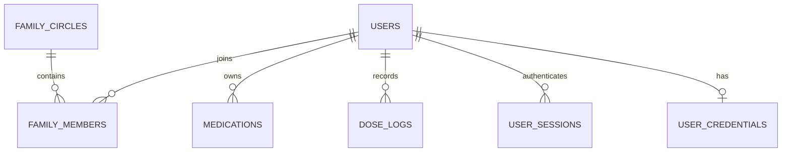

# Architecture and implementation map

Verified against source during the November 1, 2026 portfolio review. This describes the branch implementation; hosted infrastructure was not inspected.

## Request and authorization flow

1. `src/web_app.py` loads environment configuration, restores a session, builds role-dependent `st.navigation`, and renders one page.
2. `utils/session.py` caches database/auth/notification services with `st.cache_resource`. Patient read caches include caller identity, preventing cross-caller cache reuse; current TTLs range from 15 to 60 seconds. Mutation paths clear read caches.
3. Pages get caller identity from server session state. Patient IDs from URLs are untrusted. `get_patient`, medication reads/writes, dose logging, and history queries authorize in the adapter through `PatientAuthorizationMixin`.
4. The policy allows self-access; shared-circle `view` for reads; shared-circle `manage_meds` for writes. Medication-ID operations first resolve their owning patient, then authorize before mutation. Circle creators alone may change `manage_meds` permissions.
5. The adapter uses parameterized SQLite operations locally or Supabase's PostgREST client on the server. Both share policy code, but identical hosted behavior has not been demonstrated by the SQLite tests.

Some lower-level user/account, circle-membership, and worker-ledger methods accept trusted identifiers without the patient-policy check. The Python process is privileged; these methods must never become direct unauthenticated API endpoints. See [SECURITY.md](../SECURITY.md).

## Data relationships

| Table group | Purpose and important detail |
| --- | --- |
| `users`, `user_credentials`, `user_sessions` | Custom account IDs, bcrypt password hashes, random opaque bearer tokens with expiry. Not Supabase Auth. |
| `otp_verifications`, `login_attempts` | HMAC OTP digests, verification attempts/expiry, lockouts, and separately counted `otp_request` events. |
| `family_circles`, `family_members` | Many-to-many membership and permission lists. Main UI uses circle invite codes; the separate expiring `invite_codes` model is not fully wired into that flow. |
| `medications`, `dose_logs` | Medication schedules and explicit taken/missed logs. Logs reference medication names and scheduled times, not medication IDs. Duplicate dose logs are not prevented by a unique constraint. |
| `notification_log` | Unique `(patient_id, medication_name, scheduled_time, date, stage)` records suppress repeated stages once persisted. `sent_at` also timestamps superseded stages; it is not a delivery receipt. |
| `reminders`, `invite_codes` | Legacy/partially integrated tables retained to preserve functionality and history. |

SQLite initializes tables on startup. Supabase requires manual schema preparation. Both backends contain twelve application tables. The schema file enables RLS, denies client-role grants, and grants required table/sequence access to `service_role`. It does not migrate custom identities to Supabase Auth or prove an existing deployment uses these protections.

## Worker lifecycle

`src/main.py --start` loads `.env` before importing scheduler configuration. `MedicationScheduler` registers a minute interval with `max_instances=1` and coalescing, plus a Sunday 18:00 cron in `APP_TIMEZONE`. The overlap guard is per process, not a distributed lock.

`tick(db, notifier, now)` is dependency-injected orchestration with database and notification side effects—not a pure function. It scans patient schedules for the current date, skips `as_needed`, checks dose logs, chooses the most advanced due stage, and records successful/superseded stages. A failed send remains eligible for retry. Read failures are isolated by patient/dose; an overall failure is caught by the scheduler.

[Full reminder semantics and failure windows](../REMINDER_ENGINE.md).

## Source map

| Path | Responsibility |
| --- | --- |
| `src/web_app.py` | Streamlit boot, authenticated navigation, sidebar |
| `src/pages/` | Auth, Today, dashboard, patient details, medication forms, circles, onboarding, settings |
| `src/utils/authz.py` | Shared patient authorization policy and system sentinel |
| `src/utils/database.py`, `database_supabase.py`, `db_factory.py` | SQLite/Supabase implementations and environment selection |
| `src/utils/session.py` | Cached services, session persistence, caller-scoped read caches |
| `src/services/auth.py` | OTP/password/session lifecycle |
| `src/services/reminder_engine.py`, `scheduler.py`, `notifications.py` | Reconciliation, scheduling, provider adapters |
| `src/models/` | Family-circle coordination and legacy in-memory medication models |
| `src/ui/` | Theme tokens, SVG icons, reusable rendering primitives |
| `scripts/` | Isolated synthetic demo and real browser capture/smoke test |
| `tests/` | Local security/behavior tests and PostgreSQL access-boundary checks |

## Actual routes

| Route | Behavior |
| --- | --- |
| `/` | Sign-in when logged out; Today for patients; Dashboard for family members |
| `/dashboard`, `/today` | Alternate authenticated landing view, depending on role |
| `/patients?id=…` | Patient detail, with data-layer access check |
| `/add-med?patient=…` | Add medication for an authorized patient; writes require `manage_meds` or self-access |
| `/circle`, `/onboarding`, `/settings`, `/home` | Circle flows, setup, themes/sign-out, home redirect |

Auth substeps mostly live in session state, with some `?mode=` compatibility links. The originally planned `/auth/otp` and `/patients/<id>` routes are not implemented. `st.switch_page` can clear query parameters; in-app patient navigation now stores selection in session state. URL token persistence across page navigation remains a security/usability follow-up.
