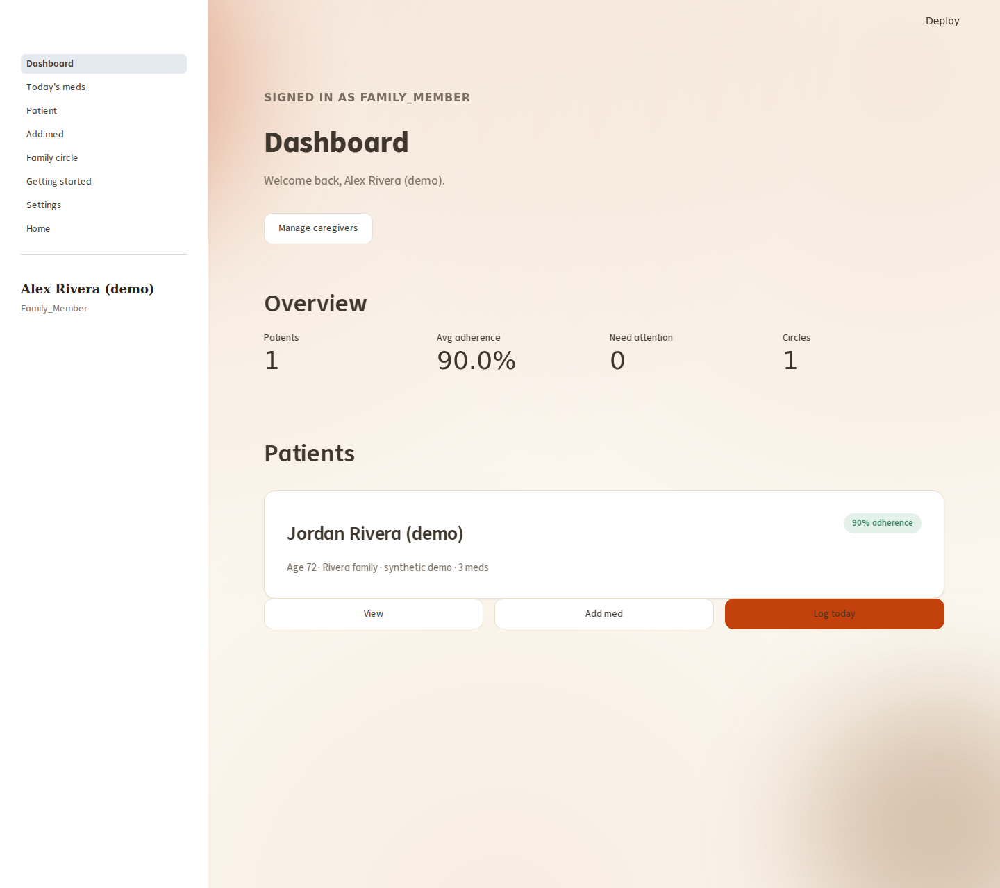
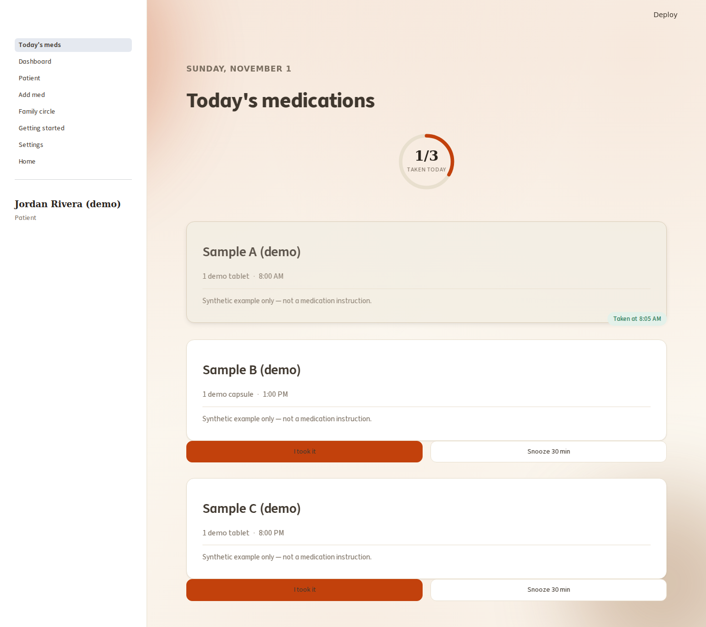
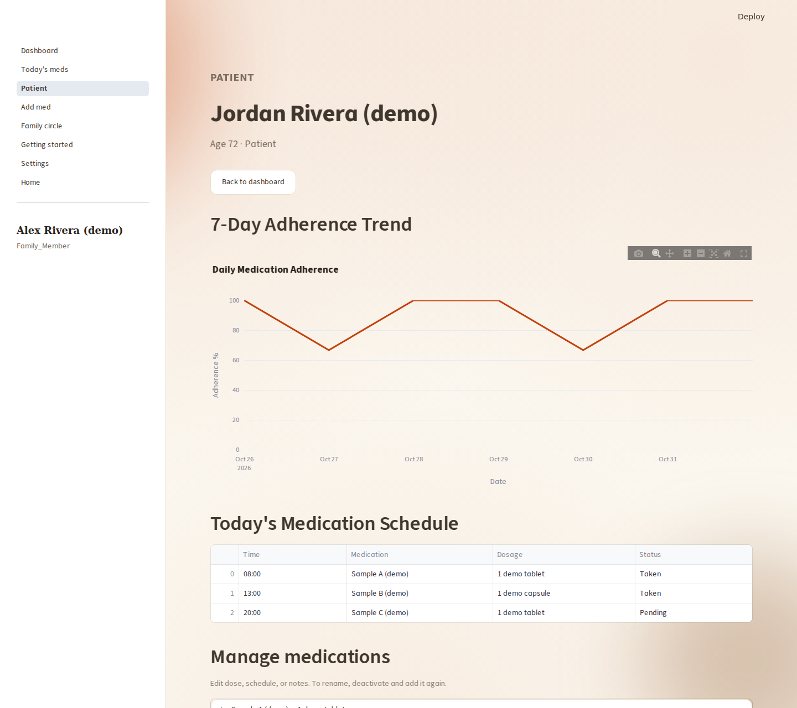

# Run and reproduce the demo

These are real screenshots of `src/web_app.py` running against a new local SQLite database. The family, medication names, doses, and history were generated by [`scripts/demo.py`](../scripts/demo.py). No patient records, real phone numbers, or service credentials are used.

## Interactive walkthrough

```bash
python scripts/demo.py
```

The terminal prints a fresh temporary password. Open `http://localhost:8501`, click **Use email instead**, and sign in as:

1. `patient@example.test`: inspect three scheduled samples; log a dose with **I took it**; try **Snooze 30 min**. Snooze changes this browser session's display, not worker escalation timing.
2. `caregiver@example.test`: see the dashboard; use **View** for history and medication management, or **Add med** for the selected patient.
3. `viewer@example.test`: see the same shared patient with read access and no write controls on Today/dashboard.

For a different port: `python scripts/demo.py --port 8503`.

The launcher binds only to `127.0.0.1`, uses a fresh temporary folder, explicitly empties Supabase/Twilio/email credentials in the child process, disables `.env` loading, and starts only the web process. It refuses to seed over an existing database. On normal exit, its temporary directory is removed. Do not repurpose this demo for real medication data.

## Captures

### Caregiver overview



The browser walkthrough logs one additional synthetic dose before capturing this view. Values are generated fixture summaries, not benchmarks or measured health outcomes.

### Today's schedule



### Patient history and management



## Reproduce screenshots and the browser smoke check

After installing the app dependencies:

```bash
python -m pip install playwright==1.51.0
python -m playwright install chromium
python scripts/capture_demo.py
```

The script starts its own isolated app on an unused loopback port, signs in through the actual email/password form, exercises logging/snooze and caregiver navigation, checks view-only controls and a 375px viewport, and captures the rendered app at 1440×1280. After those captures, it submits an additional synthetic medication, checks valid-session refresh, denied write/forged-ID routes, server-side revocation, Back navigation, and guest refresh. It does not edit the DOM or manufacture UI states. Browser requests outside loopback are blocked, so external fonts may render with fallbacks. Images are viewport captures; content below the viewport remains scrollable in the application.

Use `--output-dir /tmp/medsync-review-captures` to run the check without replacing the committed November 1 screenshots. Those original captures were preserved and re-inspected during the final review.

No SMS, email, worker, hosted database, or live-deployment claim is involved. The script terminates its child server and deletes its temporary data in `finally` blocks.
